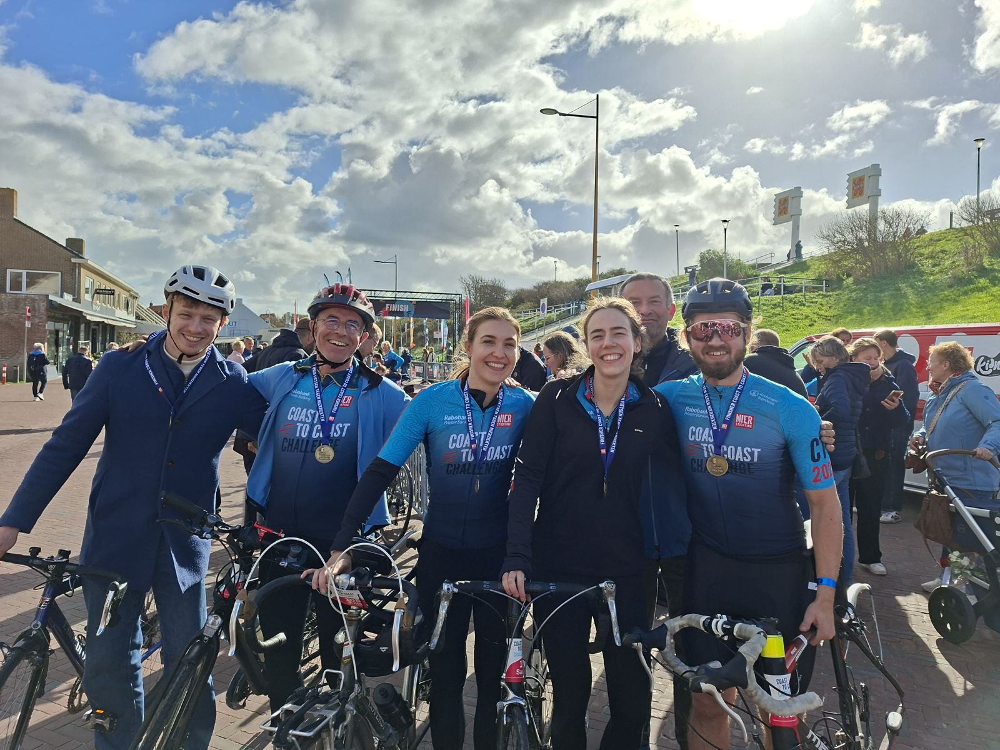

For the past four years, the Dutch Kidney Foundation has organised the Coast-to-Coast challenge: a 24-hour challenge to cycle 500km from Zoutkamp (Groningen, north of the Netherlands) to Zoutelande (Zeeland, south of the Netherlands). Both settlements contain the word salt (*Zout*) which reflects the campaign's goal: raise awareness about kidney disease while raising money for research.

Some members of our team (Roemer, Ellis, Sanne, Robin) represented U-KREAT together with colleagues/friends (Mark, Tjeerd, Roland) in this effort by cycling the challenge in relay. Despite terrible weather conditions, with lots of rainfall, thunderstorms, and stormy headwinds, we made it through.

Besides strengthening the bonds in our team, we appreciate everyone that contributed financially and otherwise to making this challenge happen and raising further awareness about kidney disease.



Until next time?

The U-KREAT team

...

#### This post's R-trick: \(x)
If you have been working in R for a longer time, you have probably started writing your own functions. This is a great way to quickly repeat code snippets without having to copy-paste. Generally, functions are defined as objects (```foo <- function(){}```), but in some cases, we would prefer shorthand. 

When we want to map a snippet of code to multiple instances of a vector/list (e.g. for-loops, lapply, apply, map), but do not want to create a specific function for that purpose, we can instead define that function anonymously: ```\(x)```. The functionality (ha) is the same, it just saves us some time:

```r
lapply(c(1, 2, 3), \(x) sqrt(x) + 1)
```

Happy coding!