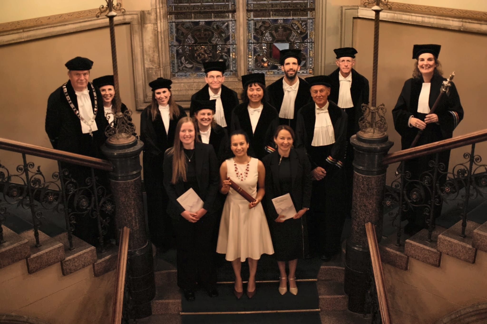

Some days at the office stand out more than others, and two weeks ago was definitely one of them. Cindy Porras defended her PhD thesis on the intersection of chronic kidney disease, peripheral arterial disease, and heart failure. The cardiorenal connection creates a loop where heart, blood vessels, and kidney diseases worsen each other through shared risks like hypertension and diabetes. Using real-world data, Cindy investigated how these conditions affect different patients, focusing specifically on sex differences, predictors of worse outcomes, and how patient health changes over time.

Surviving, and thriving during the process, a PhD trajectory requires more than good science and sharp analytical skills, but also a healthy dose of dedication and perseverance. Cindy brought plenty of that to our daily work. It has been a privilege to supervise her research, and I look forward to seeing where she takes her career next.

Interested in reading more? You can find her full thesis [here](https://doi.org/10.33540/3794)

::: {layout="[69,31]"}

:::