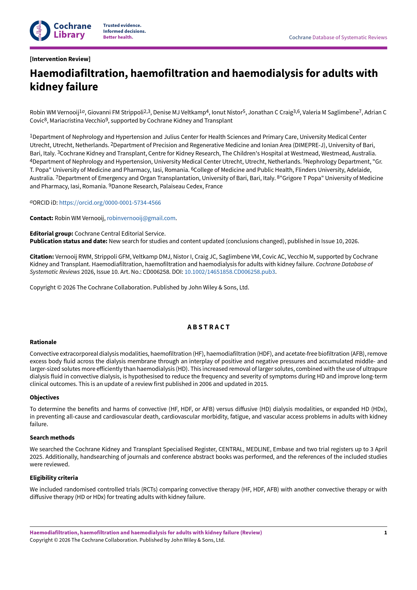
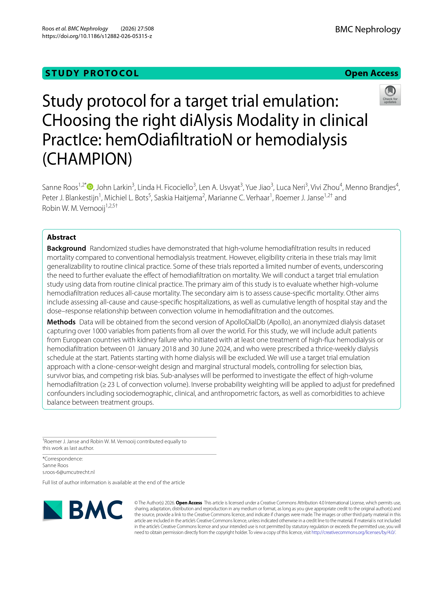
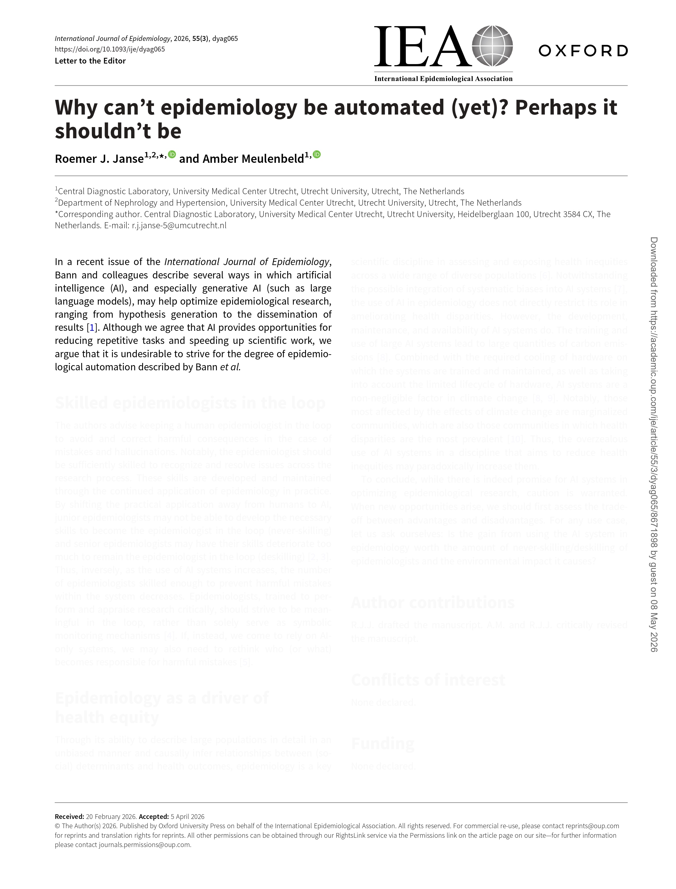
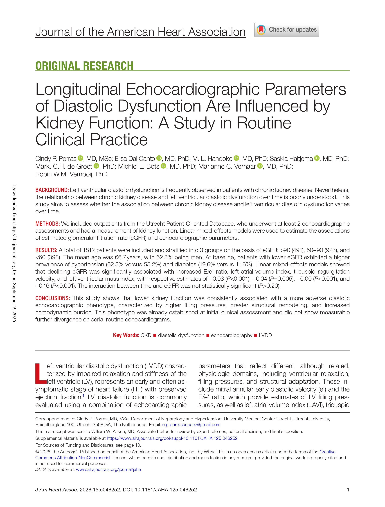
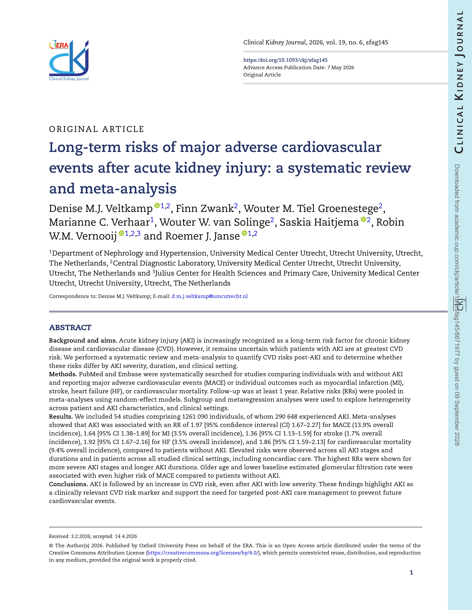
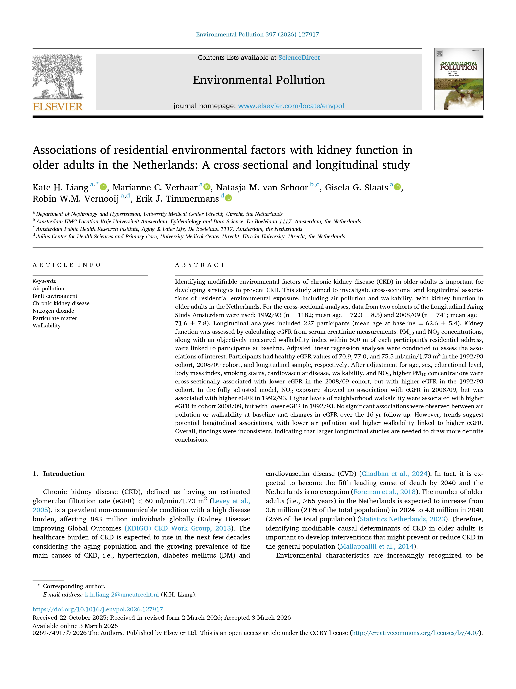

|||
|-|-|
|{.lightbox}|[**Haemodiafiltration, haemofiltration and haemodialysis for adults with kidney failure**]{style="font-size: 95%;"}   [We performed a Cochrane review to determine the benefits and harms of convective (HF, HDF, or AFB) versus diffusive (HD) dialysis modalities, or expanded HD (HDx), in preventing all-cause and cardiovascular death, cardiovascular morbidity, fatigue, and vascular access problems in adults with kidney failure. More [here](https://doi.org/10.1002%2F14651858.CD006258.pub3)]{style="font-size: 85%;"}   [Dialysis]{class="dialysis"}|
|{.lightbox}|[**Study protocol for a target trial emulation: CHoosing the right diAlysis Modality in clinical PractIce: hemOdiafiltratioN or hemodialysis (CHAMPION)**]{style="font-size: 95%;"}   [We describe the protocol for an observational causal study that aims to investigate the effect of haemodiafiltration as compared to haemodialysis on several outcomes. Analytical details are outlined. More [here](https://doi.org/10.1186/s12882-026-05315-z)]{style="font-size: 85%;"}   [Dialysis]{class="dialysis"} [Methods]{class="methods"}|
|{.lightbox}|[**Why can’t epidemiology be automated (yet)? Perhaps it shouldn’t be**]{style="font-size: 95%;"}   [We respond to an article in the *International Journal  of Epidemiology* to highlight the issues associated with Generative AI. More [here](https://doi.org/10.1093/ije/dyag065)]{style="font-size: 85%;"}   [Methods]{class="methods"} |
|{.lightbox}|[**Longitudinal Echocardiographic Parameters of Diastolic Dysfunction Are Influenced by Kidney Function: A Study in Routine Clinical Practice**]{style="font-size: 95%;"}   [We assessed the relationship between left ventricular diastolic dysfunction and chronic kidney disease over time. Lower kidney function was consistently associated with a more adverse diastolic echocardiographic phenotype, established at initial clinical assessment and without measurable further divergence. More [here](https://doi.org/10.1161/jaha.125.046252)]{style="font-size: 85%;"}   [CKM]{class="ckm"} |
|{.lightbox}|[**Long-term risks of major adverse cardiovascular events after acute kidney injury: a systematic review and meta-analysis**]{style="font-size: 95%;"}   [By studying 54 studies that together comprised 1,261,090 individuals, we showed that the relative risk of cardiovascular events after acute kidney injury is severely elevated. Elevated risks remained across AKI stages and duration. More [here](https://doi.org/10.1093/ckj/sfag145)]{style="font-size: 85%;"}   [AKI]{class="aki"}|
|{.lightbox}|[**Associations of residential environmental factors with kidney function in Dutch older adults**]{style="font-size: 95%;"}   [We investigated whether air pollution and how walkable a neighborhood is affects the kidney function of older adults in the Netherlands. The results were inconsistent and larger studies with a longer follow-up are needed before we can give a definitive answer. More [here](https://doi.org/10.1016/j.envpol.2026.127917)]{style="font-size: 85%;"}   [CKD]{class="ckd"} [Eco]{class="eco"} |

: {tbl-colwidths="[20,80]"}

