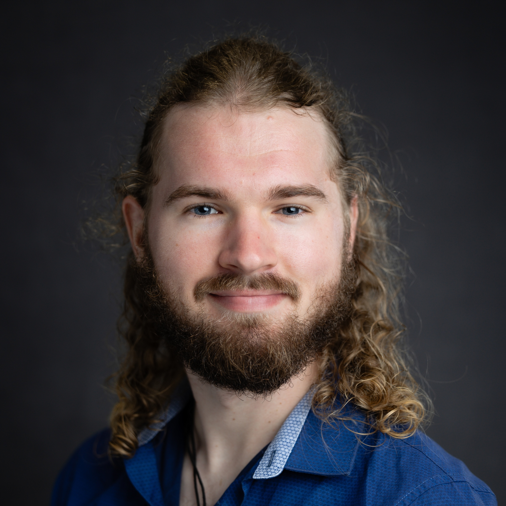
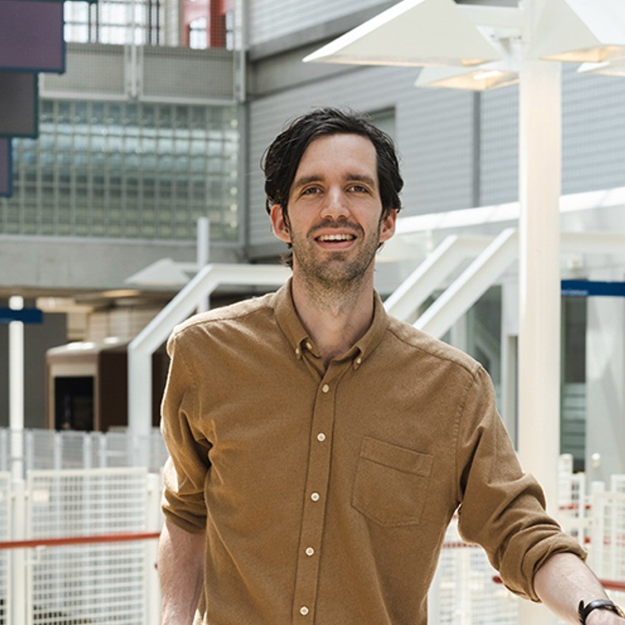
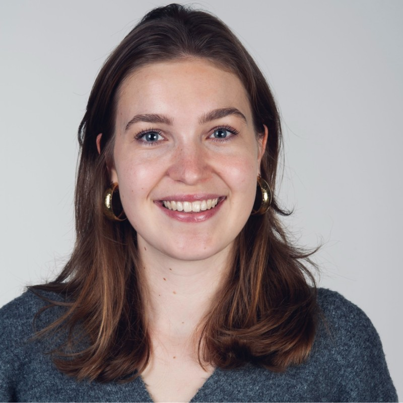
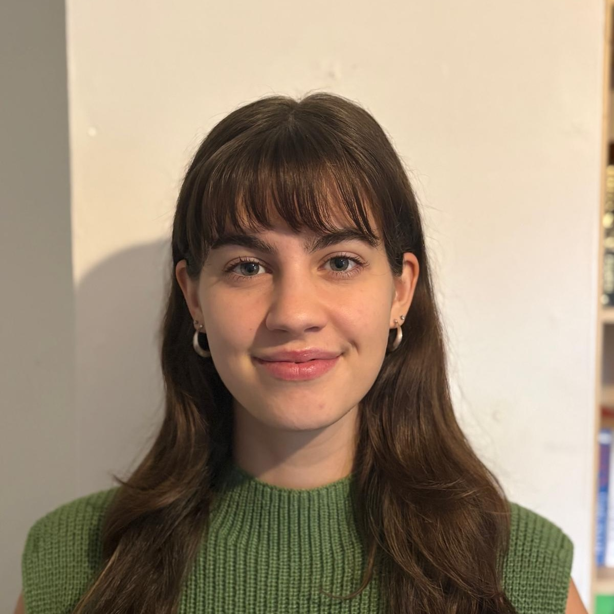
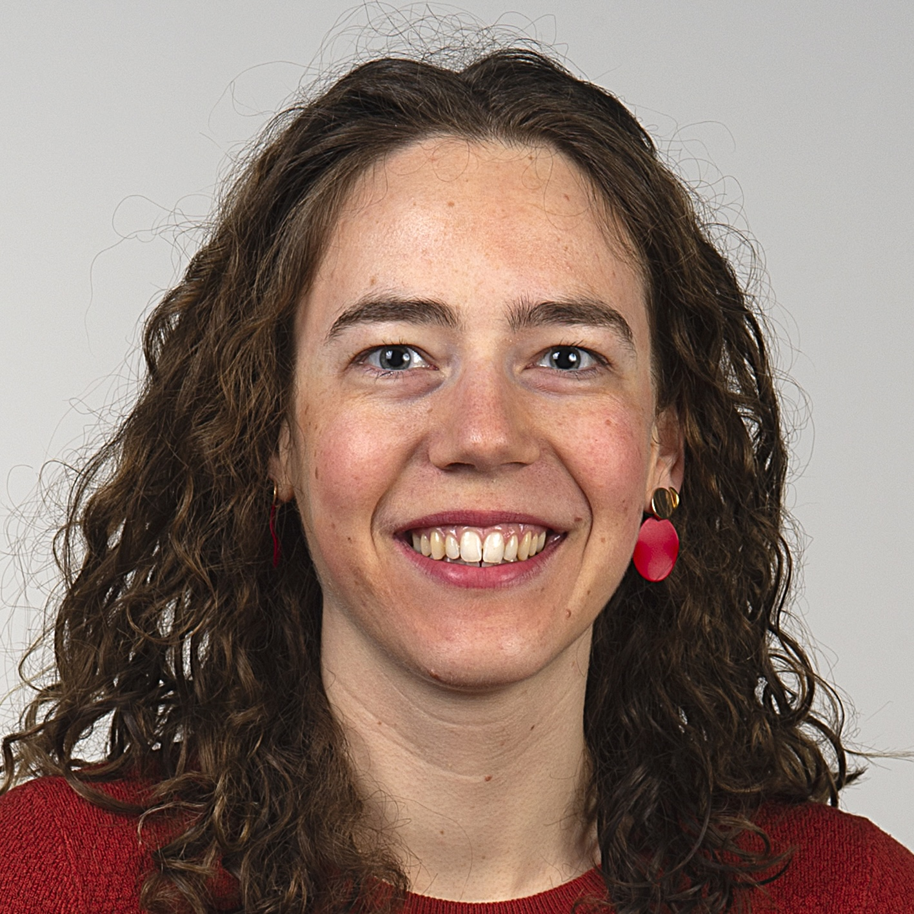
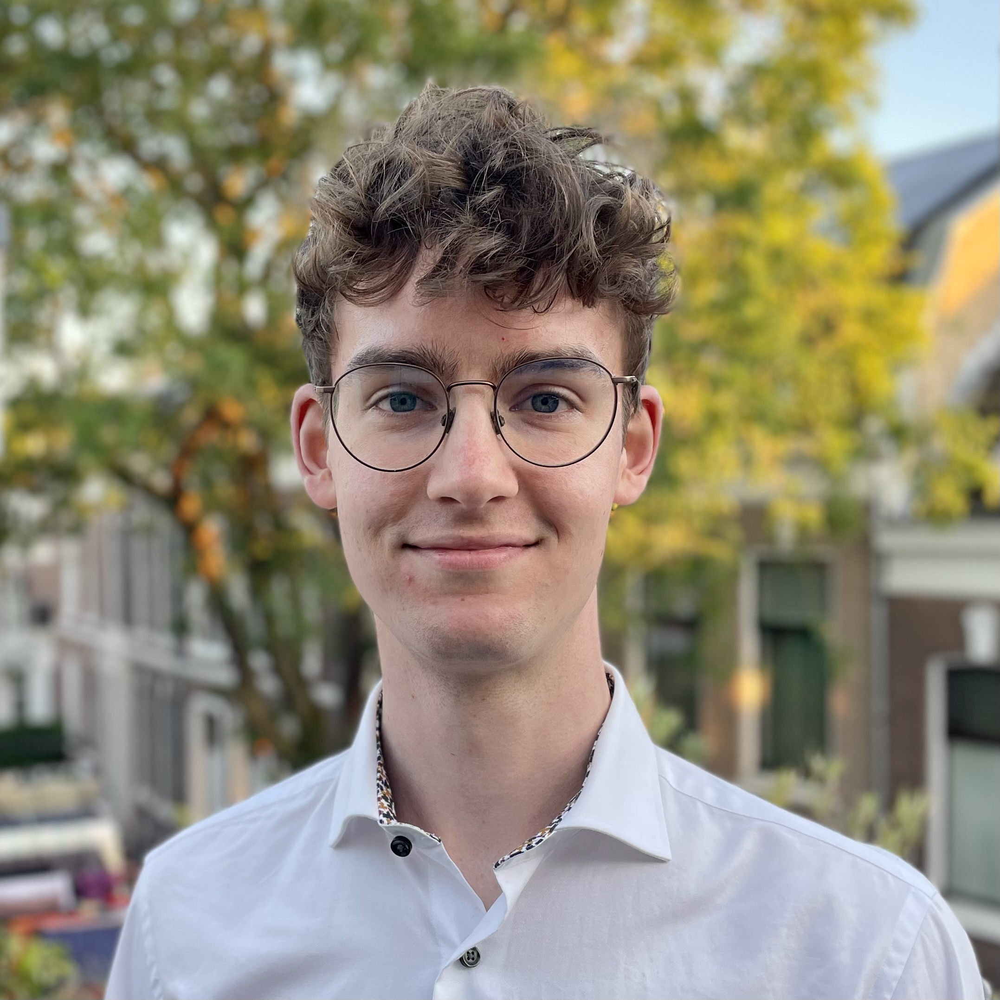

We have a number of overarching research lines, within which we perform most of our research. These research lines, spanning the kidney disease continuum and its broader derivatives (e.g. cardio-kidney-metabolic syndrome), intertwine in our work. Additionelly, we frequently work on educational/methods papers.

Details of the roles are given in @sec-roles.
\
\

## Acute kidney injury
Acute kidney injury is an impactful disease that may have long-lasting consequences affecting the cardio-kidney axis. However, these long-term outcomes remain difficult to investigate due to individual heterogeneity in individuals with acute kidney injury, difficulty in defining acute kidney injury, and reliance on smaller datasets. In this research line, we aim to overcome these shortcomings to elucidate the long-term outcomes after acute kidney injury, and heterogeneity therein.

#### People working on this
::::: {.panel-tabset}
## Rabia
:::: columns
::: {.column width="20%"}
{width=90%}
:::

::: {.column width="80%"}

- Analysis

:::
::::

## Roemer
:::: columns
::: {.column width="20%"}
{width=90%}
:::

::: {.column width="80%"}

- Analysis
- Methodology
- Investigation
- Supervision
- Funding acquisition

:::
::::

## Robin
:::: columns
::: {.column width="20%"}
{width=90%}
:::

::: {.column width="80%"}

- Principal investigator
- Conceptualisation
- Methodology
- Supervision
- Funding acquisition

:::
::::
:::::
\
\

## Chronic kidney disease
Chronic kidney disease is a heterogeneous disease with over 280 different recognised causes. Correspondingly, the population of 'people with chronic kidney disease' is also highly heterogeneous. Nonetheless, this heterogeneity goes largely unrecognised. In this research line, we aim to understand, identify, quantify, and deal with this heterogeneity.

#### People working on this
::::: {.panel-tabset}
## Ellis
:::: columns
::: {.column width="20%"}
{width=90%}
:::

::: {.column width="80%"}

- Analysis
- Investigation
- Supervision

:::
::::

## Marie Claire
:::: columns
::: {.column width="20%"}
{width=90%}
:::

::: {.column width="80%"}

- Analysis
- Investigation

:::
::::

## Roemer
:::: columns
::: {.column width="20%"}
{width=90%}
:::

::: {.column width="80%"}

- Analysis
- Methodology
- Investigation
- Supervision

:::
::::

## Robin
:::: columns
::: {.column width="20%"}
{width=90%}
:::

::: {.column width="80%"}

- Principal investigator
- Conceptualisation
- Methodology
- Supervision
- Funding acquisition

:::
::::
:::::

## Dialysis
Dialysis as a treatment for kidney failure is not a "one-size-fits-all". Several different modalities exist that work better for different people. Although the current standard is high-flux haemodialysis, in this research line, we investigate adaptations of and alternatives to high-flux haemodialysis, such as incremental dialysis and haemodiafiltration, as well as their individual application.

#### People working on this
::::: {.panel-tabset}
## Juras
:::: columns
::: {.column width="20%"}
{width=90%}
:::

::: {.column width="80%"}

- Analysis
- Investigation

:::
::::

## Elin
:::: columns
::: {.column width="20%"}
{width=90%}
:::

::: {.column width="80%"}

- Analysis
- Investigation

:::
::::

## Sanne
:::: columns
::: {.column width="20%"}
{width=90%}
:::

::: {.column width="80%"}

- Analysis
- Investigation
- Supervision

:::
::::

## Roemer
:::: columns
::: {.column width="20%"}
{width=90%}
:::

::: {.column width="80%"}

- Analysis
- Methodology
- Investigation
- Supervision

:::
::::

## Robin
:::: columns
::: {.column width="20%"}
{width=90%}
:::

::: {.column width="80%"}

- Principal investigator
- Conceptualisation
- Methodology
- Supervision
- Funding acquisition

:::
::::
:::::

## Kidney transplantation
Although kidney transplantation is the preferred treatment for kidney failure, kidney transplant recipients remain at high risk of adverse outcomes, such as cardiovascular events. In this research line, we aim to personalise care in kidney tranpslantation to prevent such adverse events.

#### People working on this
:::::{.panel-tabset}
## Roemer
:::: columns
::: {.column width="20%"}
{width=90%}
:::

::: {.column width="80%"}

- Principal investigator
- Conceptualisation
- Analysis
- Methodology
- Investigation
- Funding acquisition

:::
::::

## Robin
:::: columns
::: {.column width="20%"}
{width=90%}
:::

::: {.column width="80%"}

- Conceptualisation
- Funding acquisition

:::
::::
:::::

## Cardio-kidney-metabolic syndrome
Kidney disease is often part of a larger systemic pathological process that also involves the cardiovascular and metabolic axes. In this research line, we investigate the interplay between these axes and how we can personalise care taking into account that individuals do not fall within these single medical disciplines, but instead are subject to disease across them.

#### People working on this
::::: {.panel-tabset}
## Ellis
:::: columns
::: {.column width="20%"}
{width=90%}
:::

::: {.column width="80%"}

- Analysis
- Investigation
- Supervision

:::
::::

## Roemer
:::: columns
::: {.column width="20%"}
{width=90%}
:::

::: {.column width="80%"}

- Analysis
- Methodology
- Investigation
- Supervision
- Funding acquisition

:::
::::

## Robin
:::: columns
::: {.column width="20%"}
{width=90%}
:::

::: {.column width="80%"}

- Principal investigator
- Conceptualisation
- Methodology
- Supervision
- Funding acquisition

:::
::::
:::::

## Green kidney care
Several kidney treatments come at a high cost, not only financially, but also in terms of climate impact. Understanding climate impact across the breadth of kidney-related interventions is essential to delivering green kidney care that is good for both the patient and the planet.

#### People working on this
::::: {.panel-tabset}
## Tibo
:::: columns
::: {.column width="20%"}
{width=90%}
:::

::: {.column width="80%"}

- Analysis
- Investigation

:::
::::

## Robin
:::: columns
::: {.column width="20%"}
{width=90%}
:::

::: {.column width="80%"}

- Principal investigator
- Conceptualisation
- Methodology
- Supervision
- Funding acquisition

:::
::::
:::::

## Educational/methods
We write several papers on methodology, explaining them to a (relatively) lay audience, providing a *just-in-time* learning approach to the interpretation of sophisticated epidemiological analyses.

#### People working on this
::::: {.panel-tabset}
## Roemer
:::: columns
::: {.column width="20%"}
{width=90%}
:::

::: {.column width="80%"}

- Conceptualisation
- Methodology

:::
::::

## Robin
:::: columns
::: {.column width="20%"}
{width=90%}
:::

::: {.column width="80%"}

- Conceptualisation
- Methodology

:::
::::
:::::

#### Elaboration on roles {#sec-roles}

|Role|Elaboration|
|-|-|
|Principal investigator|Research line lead|
|Conceptualisation|Generation of overarching ideas and direction|
|Methodology|Specification of specific project methodology|
|Investigation|Adaptation of methodology to specific project|
|Supervision|Supervision of PhD-, master-, or bachelorstudents|
|Funding acquisition|Seeking financial support for overarching research line|