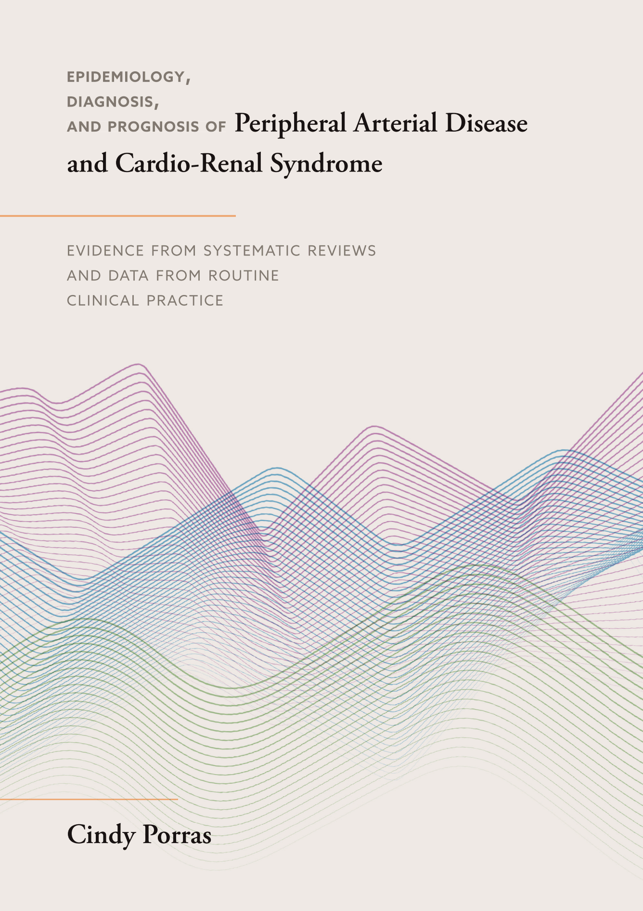

:::: {.columns}
::: {.column width="30%"}
[{style="padding-right: 20px"}](https://doi.org/10.33540/3794)
:::

::: {.column width="70%"}
**Epidemiology, diagnosis, and prognosis of Peripheral Arterial Disease and Cardio-Renal Syndrome**  
*Evidence from systematic reviews and data from routine clinical practice*

**Cindy P. Porras** - 2026/11/27

:::
::::

